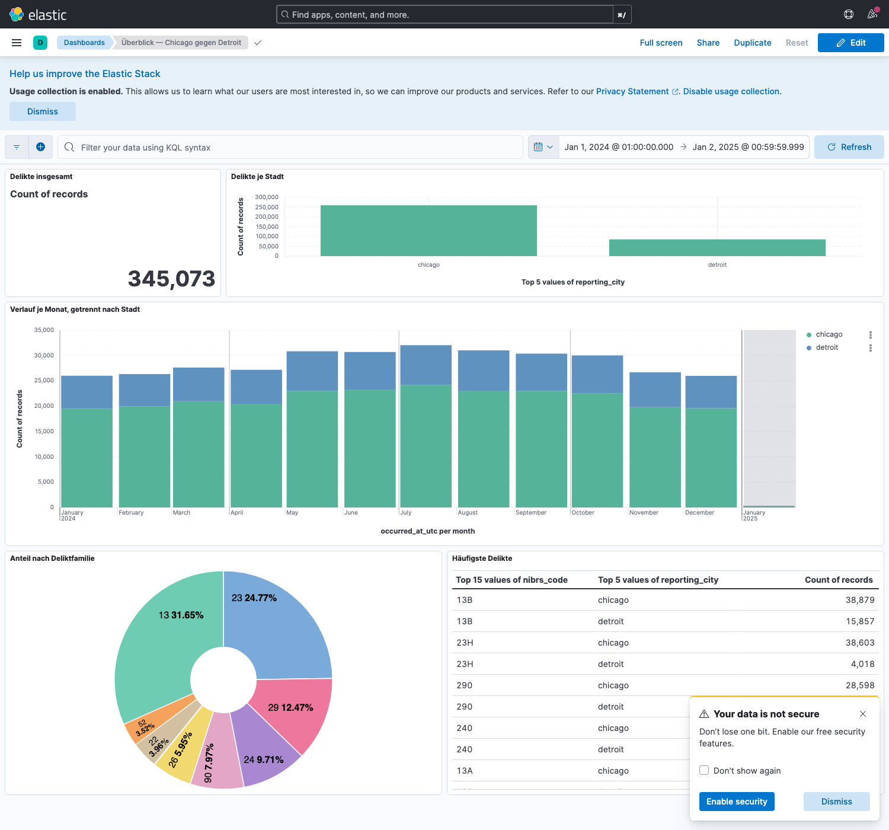

# Crime-Data-Gruppe3

[](https://github.com/artanmusollaj-ops/Crime-Data-Gruppe3/actions/workflows/tests.yml)

Vergleich der Kriminalitätsdaten von **Chicago und Detroit für das Jahr 2024** —
eine Semesterarbeit im CAS Data Engineering.

Die Frage klingt einfach und ist es nicht: *Wo passiert was, wie oft, im
Verhältnis zu wie vielen Menschen?* Beide Städte veröffentlichen ihre Falldaten
offen, aber sie tun es unvergleichbar. Chicago liefert eine Zeile je Delikt und
codiert nach **IUCR**, Detroit eine Zeile je **Anklage** und codiert nach
**MICR**. Chicagos Zeitstempel ist Ortszeit ohne Zonenangabe, Detroits ist UTC.
Und keine der beiden Quellen sagt, zu welcher Stadt ein Gebiet gehört — ohne
Stadtgrenze gibt es keinen Nenner und damit keine Rate je Einwohner.

Dieses Repository baut die Strecke, die aus zwei unvergleichbaren Quellen eine
vergleichbare Tabelle macht:

```text
        Chicago ─┐
        Detroit ─┤
  Census TIGER ──┼──▶  raw ─▶ bronze ─▶ silver ─▶ gold ─▶ serving ─▶ releases
    Census ACS ──┤       │       │         │        │        │           │
     NOAA GHCN ──┘    Beweis  geparst   gedeutet  Stern   Abfragen   freigegeben
```

| Schicht | Was sie ist |
| --- | --- |
| **raw** | die Antwort der Quelle, Byte für Byte, mit SHA-256. Nicht rekonstruierbar |
| **bronze** | daraus abgeleitetes Parquet mit gepinntem Schema. Deutet nichts |
| **silver** | die erste deutende Schicht: Typen, Einheiten, Zeitzonen, NIBRS, Raum |
| **gold** | Sternschema mit einer Faktentabelle je Tat und vier Dimensionen |
| **serving** | DuckDB-Sichten über die Schichten, dazu vier aus Gold abgeleitete Vergleichstabellen |
| **releases** | ein freigegebener Gesamtstand unter einer Kennung, unveränderlich, mit Prüfsummen |

**Der Stand in Zahlen** — was gerade in den Schichten liegt:

| | |
| --- | ---: |
| Jahrgänge | **2021–2026**, 2026 als Teiljahr |
| `silver/crime_offense` | 1'875'374 Zeilen (Detroit: eine Anklage) |
| `gold/fact_offense` | 1'851'946 Zeilen (eine Tat) |

Und die Raten, **für den Jahrgang 2024** — eine Rate braucht einen Zeitraum,
der Bestand trägt sechs:

| | |
| --- | ---: |
| Chicago | 251'513 Delikte · 2'661'953 Einwohner · **94,5** je 1'000 |
| Detroit | 84'987 Delikte · 638'635 Einwohner · **133,1** je 1'000 |

Wo etwas ausführlich steht:

| Was | Wo |
| --- | --- |
| **Welches Dokument für wen** — Abgabe, intern, erzeugt | [`docs/README.md`](docs/README.md) |
| Konzept, Methode, Befunde | [`docs/ln2_konzept.md`](docs/ln2_konzept.md) |
| Wie der Aufbau zusammenhängt | [`docs/architektur.md`](docs/architektur.md) |
| Ist- und Ziel-Architektur, für den Leistungsnachweis | [`docs/architektur-ist-und-ziel.md`](docs/architektur-ist-und-ziel.md) |
| Dieselbe Architektur auf **einer A4-Seite**, zum Ausdrucken | [`docs/architektur-einseiter.html`](docs/architektur-einseiter.html) |
| Woher eine Zahl kommt, Stufe für Stufe | [`docs/eine-zahl.md`](docs/eine-zahl.md) |
| Was beim Aufräumen verlorenginge | [`docs/intern/datenhistorie.md`](docs/intern/datenhistorie.md) |
| Vier Arten zu zählen, und was sich nicht addiert | [`docs/zaehlperspektiven.md`](docs/zaehlperspektiven.md) |
| Welche Kontrolle wo greift, vorgeführt | [`notebooks/35`](notebooks/35_kontrollen.ipynb) |
| Die Hypothesen H1 bis H6, nachgewiesen | [`notebooks/36`](notebooks/36_hypothesen.ipynb) |
| Wie sich die Quellen bewegen — was sie nachträglich ändern | [`notebooks/37`](notebooks/37_quellbewegung.ipynb) |
| Jedes Modul, jede Funktion | [`docs/referenz/`](docs/referenz/index.html) |
| Was jede Spalte bedeutet | [`docs/feldkatalog.md`](docs/feldkatalog.md) |
| Was sich wann geändert hat und warum | [`docs/intern/AENDERUNGEN.md`](docs/intern/AENDERUNGEN.md) |
| Würfel und Sternschema erklärt | [`docs/sternschema-und-wuerfel.md`](docs/sternschema-und-wuerfel.md) |
| Wie die Ablage funktioniert: Modi, Publizieren, Holen, Releases | [`docs/storage-architektur.md`](docs/storage-architektur.md) |
| Was als Nächstes anstünde und warum nicht jetzt | [`docs/ausblick.md`](docs/ausblick.md) |
| Absprache und Leistungsnachweise | [`docs/intern/projektabsprache.md`](docs/intern/projektabsprache.md), [`docs/intern/leistungsnachweise.md`](docs/intern/leistungsnachweise.md) |
| Detroit-Pipeline im Detail | [`docs/intern/DETROIT_PIPELINE_ANLEITUNG.md`](docs/intern/DETROIT_PIPELINE_ANLEITUNG.md) |
| Die Quellen einzeln erklärt | [`notebooks/`](notebooks/) 01, 11, 21, 22, 32 |
| Datenqualität je Stadt | [`notebooks/03`](notebooks/03_chicago_data_quality.ipynb), [`notebooks/13`](notebooks/13_detroit_data_quality.ipynb) |

---

## 1 · Einrichten

**Voraussetzungen:** Python 3.11 oder neuer, Git.

**Nicht in einem Sync-Ordner arbeiten.** Das Projekt gehört nicht nach
`~/Documents`, `OneDrive` oder `iCloud Drive`. Sync-Dienste legen mitten im
Betrieb Konfliktkopien an (`datei 2.txt`), ändern Dateirechte und können sowohl
die virtuelle Umgebung als auch `.git/` beschädigen. Ein Ort wie
`~/Projekte/Crime-Data-Gruppe3` ist richtig; versioniert wird über GitHub, eine
zweite Synchronisation braucht es nicht.

### 1.1 Umgebung anlegen

```bash
python -m venv .venv
source .venv/bin/activate
python -m pip install -r requirements.txt
```

`requirements.txt` installiert das Projekt editierbar; die Abhängigkeiten stehen
in `pyproject.toml` als Bereiche. Wer **exakt** den Stand will, mit dem CI
unter Python 3.13 läuft:

```bash
python -m pip install -r requirements.lock && python -m pip install -e . --no-deps
```

Der Unterschied ist real — am 13.9. hatte ein Rechner `numpy 2.5.2`, der frische
Klon `2.5.3`. Danach sind alle Pipelines importierbar, unabhängig vom
aktuellen Verzeichnis:

```text
src/crime/
├── chicago_pipeline/   → import chicago_pipeline
├── detroit_pipeline/   → import detroit_pipeline
├── census_pipeline/    → import census_pipeline
├── weather_pipeline/   → import weather_pipeline
├── silver_pipeline/    → import silver_pipeline
├── gold_pipeline/      → import gold_pipeline
├── serving/            → import serving
├── manifeste/          → import manifeste      (ein Leser für alle Manifeste)
├── storage/            → import storage        (lokal, SeaweedFS, Releases)
└── orchestration/      → import orchestration  (Gesamtlauf, Aufräumen, Drift)
```

**Anaconda oder Miniconda installiert?** Dann ist `python` in einer frischen
Shell der Conda-Interpreter: Die von `conda init` erzeugte Zeile in `~/.zshrc`
aktiviert bei jedem Start automatisch die Umgebung `base`. Ein `python -m venv
.venv` legt die Umgebung damit auf Conda an — mit einer anderen Python-Version
und anderen Paketversionen als in `pyproject.toml` vorgesehen. Den Interpreter
beim Anlegen deshalb ausschreiben:

```bash
which -a python3    # zeigt alle Interpreter im PATH
/Library/Frameworks/Python.framework/Versions/3.13/bin/python3.13 -m venv .venv
```

Nach dem Aktivieren zählt nur, worauf `python` tatsächlich zeigt — nicht, was im
Prompt steht:

```bash
source .venv/bin/activate
which python     # .../<projekt>/.venv/bin/python
python -V        # Python 3.13.0
```

**`conda deactivate` ist nicht die Lösung.** `source .venv/bin/activate` stellt
`.venv/bin` an den Anfang des `PATH` und gewinnt damit gegen Conda; eine intakte
Umgebung braucht kein `deactivate`. Zeigt `which python` trotz `(.venv)` im
Prompt auf Conda, geht der Eintrag im `PATH` ins Leere — dann hilft nur, die
Umgebung neu anzulegen. Conda aus dem `PATH` zu nehmen holt lediglich den
nächsten falschen Interpreter nach vorn.

**Die Umgebung lässt sich nicht verschieben.** `.venv/bin/activate` und jedes
Konsolenskript darin enthalten den absoluten Pfad, unter dem die Umgebung
angelegt wurde. Wird das Projekt verschoben oder kopiert, zeigt dieser Pfad ins
Nichts: Der Prompt meldet weiterhin `(.venv)`, `python` fällt aber auf den
nächsten `PATH`-Eintrag durch — auf Conda. Da `.venv` in `.gitignore` steht und
ohnehin nie mitwandert, nach einem Umzug löschen und neu anlegen.

### 1.2 Zertifikate prüfen (nur macOS)

Die Detroit-Pipeline nutzt `urllib` aus der Standardbibliothek. Python-Versionen
von python.org bringen dort **keinen** Zertifikatsspeicher mit, jeder
HTTPS-Aufruf endet dann nach fünf Wiederholungen in
`CERTIFICATE_VERIFY_FAILED`. Einmalig pro Rechner:

```bash
open "/Applications/Python 3.13/Install Certificates.command"
```

Die Chicago-Pipeline ist nicht betroffen, sie nutzt `requests` mit eigenem
Zertifikatsbündel — deshalb kann Chicago laufen, während Detroit scheitert.

### 1.3 Schlüssel hinterlegen

Eine Datei `.env` im Projekt-Root, nach dem Muster von `.env.example`. Sie ist
über `.gitignore` ausgeschlossen.

**Wer lokal arbeitet, braucht zwei Zeilen** — und keine davon betrifft den
gemeinsamen Speicher:

```text
CENSUS_API_KEY=dein_schluessel     # Pflicht für die ACS-Daten
SOCRATA_APP_TOKEN=dein_token       # optional, für Chicago
```

**`CENSUS_API_KEY` ist Pflicht**, wenn Census-Daten geladen werden sollen —
kostenlos unter <https://api.census.gov/data/key_signup.html>. Ohne ihn
antwortet die API mit **HTTP 200** und einer HTML-Seite „Missing Key" statt mit
einem Fehlerstatus; die Pipeline erkennt das und bricht ab, statt eine leere
Tabelle zu schreiben.

`SOCRATA_APP_TOKEN` ist optional. Ohne Token funktioniert der öffentliche
Zugriff auf Chicago ebenfalls, wird aber stärker gedrosselt.

**Den gemeinsamen Speicher braucht es nur, wenn du ihn willst.** `data/` ist
die Vorgabe; solange `STORAGE_BACKEND` fehlt oder auf `local` steht, wird
keine einzige `S3_`-Variable gelesen und `boto3` nie importiert. Wer den
Bestand mit dem Team teilen will, ergänzt drei Zeilen (mehr zu den Modi
in 2.5):

```text
STORAGE_BACKEND=hybrid             # lokal zuerst, SeaweedFS als Rückfall
S3_ACCESS_KEY=dein_schluessel
S3_SECRET_KEY=dein_geheimnis
```

| Variable | Vorgabe | wann nötig |
| --- | --- | --- |
| `STORAGE_BACKEND` | `local` | für `hybrid` und `s3` |
| `S3_ACCESS_KEY`, `S3_SECRET_KEY` | — | für `hybrid` und `s3`, sonst nie |
| `S3_ENDPOINT` | `s3.datenwerft.ch` | nur bei abweichendem Server |
| `S3_BUCKET` | `urban-crime` | nur bei abweichendem Bucket |
| `LOCAL_DATA_ROOT` | `data` | nur bei abweichendem Verzeichnis |

Fehlt ein Schlüssel, sagt es die Konfiguration sofort und nennt die Variable
— nicht erst die fünfte Pipeline-Stufe. Prüfen mit `python -m storage`.

### 1.4 Einrichtung prüfen

```bash
python -m pytest
```

Erwartet wird **grün**: 2'003 ausgeführte Tests, ohne Netzzugriff und ohne
Schlüssel. Läuft das durch, ist die Einrichtung in Ordnung — die Tests arbeiten
mit kleinen Fixtures und simulierten Quellen.

Die Summenzeile nennt daneben **108 abgewählte**. Das sind die Wächter mit dem
Marker `referenzstand`, und der Standardlauf lässt sie bewusst aus:

```bash
python -m pytest                     # alles ausser dem Referenzstand
python -m pytest -m referenzstand    # genau diese Wächter
python -m pytest -m ""               # beides zusammen, alle 2'114
```

> **Warum sie nicht im Standardlauf stehen.** Sie halten die dokumentierten
> Zahlen gegen die gebauten Parquet-Dateien. Sobald eine frische Ingestion
> gelaufen ist, stehen die Daten vor dem dokumentierten Stand, und diese
> Wächter werden rot — das ist ihre Aufgabe, kein Fehler in der Einrichtung.
> Am 18.9.2026 waren es 34 von 71 auf einmal, und in diesem roten Rauschen
> wäre ein echter Fehlschlag untergegangen. Wie weit es auseinander ist, sagt
> `python -m orchestration.drift`; die Entscheidung dazu steht in
> [`docs/intern/datenhistorie.md`](docs/intern/datenhistorie.md) 8.

Bei der weiteren Arbeit genügt `source .venv/bin/activate`; verlassen wird die
Umgebung mit `deactivate`.

### 1.5 Die Code-Referenz

```bash
python tools/build_referenz.py
```

`docs/referenz/` liegt im Repository — `docs/referenz/index.html` lässt sich
also direkt öffnen, ohne vorher etwas zu bauen. Eine Seite je Modul, mit Suche
und dem Quelltext daneben, aus den Docstrings.

Der Befehl oben baut sie neu, und **das gehört nach jeder Änderung an einem
Docstring dazu** — genau wie beim Feldkatalog und bei den Architekturbildern.
Ein Test hält die abgelegten Seiten gegen einen frischen Bau und wird rot,
wenn sie auseinanderlaufen.

Der Bau setzt dafür `PYTHONHASHSEED` und startet sich einmal selbst neu. Ohne
das wäre die Ausgabe von Lauf zu Lauf verschieden, weil pdoc Mengen mit `repr`
druckt und deren Reihenfolge am Hashwert hängt.

Wer lieber ein fertiges Paket herunterlädt: Jeder Lauf auf `main` hängt die
Referenz unter *Actions → Tests → code-referenz* als Artefakt an.

---

## 2 · Daten laden

Die Reihenfolge ist nicht beliebig: Jede Schicht liest die darunter. Von einem
leeren `data/` aus sind es drei Blöcke.

> **Hinweis:** `data/` steht in `.gitignore` — die Daten wandern nicht über Git.
> Wer frisch klont, lädt sie mit den Schritten unten selbst. Rechnen Sie mit
> rund zehn Minuten, das meiste davon Wartezeit an den APIs.

### 2.0 Alles auf einmal

```bash
python -m orchestration.run_all                  # alles, inklusive Ingestion
python -m orchestration.run_all --ohne-ingestion # nur neu ableiten
python -m orchestration.run_all --trocken        # nur zeigen, was liefe
python -m orchestration.run_all --jahre 2021-2026 --bis silver   # mehrere Jahrgänge
```

`--jahre` nimmt `2024`, `2021-2026` oder `2021,2023`; Vorgabe ist 2024, ein
Aufruf ohne die Option tut also genau das, was er vorher tat. Die
Kriminalquellen laufen **je Jahrgang**, die Census-Stufen **je Vintage**, NOAA
und die abgeleiteten Stufen einmal — aus 2021–2026 werden so 39 Stufen statt
14. Ab 2025 bleibt es beim 2024er Vintage, weil es kein neueres gibt; eine Rate
für 2025 ruht damit auf der Bevölkerung von 2024.

Mehr als ein Vintage und **Gold im Lauf** lehnt der Controller vorerst ab, mit
Grund und **vor der ersten Stufe**: `build_gold` nimmt ein einzelnes
`--vintage` und verbindet alles damit, jede Tat von 2021 bekäme also den
Nenner von 2024 — und das Ergebnis sähe vollständig aus. Bis Gold je Jahrgang
wählt, geht ein Mehrjahreslauf mit `--bis silver`.

Der Controller kennt die Reihenfolge, bricht bei der ersten gescheiterten Stufe
ab und schreibt `data/pipeline_run.json`. Mit `--maximal-alter-tage 8` scheitert
er ausserdem, wenn der jüngste Lauf einer Quelle älter ist — bei
`--ohne-ingestion` schon **vor** der ersten Stufe, weil die Daten dabei nicht
frischer werden. Das Manifest enthält: welche Stufen liefen, **auf welchen
Bronze-Läufen** das Ergebnis ruht, wie alt jede Quelle ist, welche Läufe von
SeaweedFS geholt wurden, ob ein Release entstand, und einen Fingerabdruck über
die Eingaben. Zwei Läufe auf demselben Stand tragen denselben Fingerabdruck.

Im **Hybridmodus** kommen zwei Schritte dazu, die man nicht aufrufen muss:
Vorher werden alle Raw- und Bronze-Läufe geholt, die auf SeaweedFS liegen und
lokal fehlen; nachher — und nur nach einem vollständigen grünen Lauf — entsteht
ein **Release**, das publiziert wird. Beides lässt sich abschalten, und im
`local`-Modus lässt sich das Release erzwingen (Abschnitt 2.5):

```bash
python -m orchestration.run_all --ohne-holen     # nichts von SeaweedFS holen
python -m orchestration.run_all --ohne-release   # kein Release bilden
python -m orchestration.run_all --release        # auch im local-Modus eines bilden
```

Die Abschnitte darunter erklären, was er tut — und sie sind der Weg, wenn nur
eine Stufe neu laufen soll.

### 2.1 Ingestion — raw und bronze

Jeder Aufruf schreibt einen **unveränderlichen Lauf**: erst in ein verstecktes
`.part`-Verzeichnis, dann atomar veröffentlicht, zuerst raw, dann bronze. Beide
teilen dieselbe `run_id`. Frühere Läufe werden nie überschrieben.

```bash
# Chicago — erster Aufruf lädt 2024 vollständig,
# spätere erkennen das Wasserzeichen und laden ein Delta mit 14 Tagen Überlappung
python -m chicago_pipeline.download_chicago

# Detroit — genauso: erster Aufruf lädt 2024 vollständig,
# spätere laden nur, was sich seit dem Wasserzeichen geändert hat
python -m detroit_pipeline.extract_detroit --mode delta --years 2024

# Census: Geometrien (Tracts und Stadtgrenzen) und Einwohnerzahlen
python -m census_pipeline.download_tiger --auslieferung tract
python -m census_pipeline.download_tiger --auslieferung place
python -m census_pipeline.download_acs

# Wetter: je Stadt eine Station
python -m weather_pipeline.download_noaa
```

**Worauf Detroits Delta geht — und warum nicht aufs Tatdatum.** **55,9 %** des
Jahrgangs 2024 wurden *mehr als ein Jahr nach der Tat* noch geändert — gemessen
am Schnappschuss vom 18.9.2026 in
[Notebook 13](notebooks/13_detroit_data_quality.ipynb), Schritt 12. Die Zahl
steigt mit jedem Schnappschuss; am 17.9. waren es 54,6 %. Ein Delta
nach Tatdatum hätte keine einzige dieser Korrekturen gesehen — daran ist der
erste Versuch gescheitert, und bis zum 18.9.2026 lud Detroit deshalb jedes Mal
den ganzen Jahrgang.

Die Messung sagt aber nicht, dass kein Delta geht, sondern **worauf** es gehen
muss. Über vier Schnappschüsse haben sich 1'270 Zeilen inhaltlich geändert —
Beschreibung, Code, Kategorie, Fallstatus, Tatzeitpunkt oder Koordinate. *Jede
einzelne* trug dabei einen neuen `updated_at`; keine änderte sich ohne. Der
Ladeweg ist deshalb derselbe wie bei Chicago, nur mit zwei Bedingungen statt
einer: **der Jahrgang nach Tatzeit, darin das Geänderte nach `updated_at`**, mit
denselben 14 Tagen Rückgriff. Vier Zeilen tragen gar keinen Stempel; sie kommen
über `OR updated_at IS NULL` immer mit, sonst hätten sie nie wieder eine Chance.

Der erste Aufruf auf einem leeren Rechner findet kein Wasserzeichen und lädt den
Jahrgang voll — 88'686 Zeilen. Der zweite lud 3'184.

**Was raw und bronze unterscheidet.** Raw ist das Beweisstück: die Antwort Byte
für Byte, gzip-komprimiert mit `mtime=0`, damit der SHA-256 im Manifest allein
von der Antwort abhängt. Ein Delta-Lauf hält Datensätze so fest, wie sie in
diesem Moment waren — das lässt sich später nicht rekonstruieren. Bronze ist
daraus abgeleitet und jederzeit neu erzeugbar; es behält die Originaltypen der
Quelle und deutet nichts. Alles Unerwartete landet in einer Auffangspalte
`_extra`, statt verworfen zu werden.

Ein Lauf sieht so aus:

```text
data/
├── raw/city=chicago/ingest_date=2026-09-05/run_20260905T174014844258Z/
│   ├── page-0001.json.gz
│   └── manifest.json
└── bronze/city=chicago/ingest_date=2026-09-05/run_20260905T174014844258Z/
    ├── part-0001.parquet
    └── manifest.json
```

Partitioniert wird nach dem **Abrufdatum**, nicht nach dem Tatdatum.

Für einen kleinen Test ohne Spuren im echten `data/`:

```bash
python -m chicago_pipeline.download_chicago \
  --data-root /tmp/chicago-test --max-records 5
```

### 2.2 Silver — die erste deutende Schicht

```bash
python -m silver_pipeline.build_tract          # zuerst: crime_offense braucht ihn
python -m silver_pipeline.build_place
python -m silver_pipeline.build_weather_day
python -m silver_pipeline.build_crime_offense
```

Anders als Bronze wird Silver **ersetzt und nicht angehäuft** — die Schicht ist
abgeleitet und jederzeit neu erzeugbar. Das Manifest nennt trotzdem die `run_id`
jedes Bronze-Laufs, aus dem die Tabelle entstand.

Vier Tabellen, weil die Quellen vier Granularitäten haben. Sie in eine zu zwingen würde
Zeilen vervielfachen — ein Wetterwert an jedem Delikt derselben Stadt und
desselben Tages — oder Information wegwerfen:

| Tabelle | Eine Zeile ist | Zeilen |
| --- | --- | ---: |
| `tract` | ein Census Tract | 6'282 |
| `place` | ein Ort (Stadtgrenze) | 2'206 |
| `weather_day` | eine Stadt an einem Tag | 55'497 |
| `crime_offense` | eine **Anklage**; je Tat zählt eine | 1'875'374 |

`crime_offense` leistet drei Übersetzungen auf einmal, und jede ist ein eigener
Fehlerherd:

* **Delikte.** Chicagos `iucr` und Detroits `state_offense_code` gehen über
  [`config/iucr_nibrs_mapping.csv`](config/) und
  [`config/micr_nibrs_mapping.csv`](config/) auf **NIBRS**, die bundesweite
  Codeliste. Detroit vollständig, Chicago bis auf **drei Zeilen** ohne Code —
  sie tragen `mapping_status = unmapped` und bleiben zählbar.
* **Zeit.** Chicagos `date` sieht aus wie ein Zeitstempel, ist aber Ortszeit
  ohne Zone; Detroits Feld ist bereits UTC. Wer beide gleich behandelt,
  vergleicht Städte, die je nach Jahreszeit ein bis zwei Stunden
  auseinanderliegen. Die Tabelle führt deshalb `occurred_at_utc` **und**
  `occurred_at_local`.
* **Raum.** Punkt-in-Polygon gegen `tract`, damit beide Städte dieselbe
  Raumeinheit tragen. Chicago 99,3 % verortet, Detroit 99,7 %.

**Die Tabelle wirft nichts weg.** Weder unverortete Fälle noch solche ohne
NIBRS-Zuordnung noch Detroits `UNFOUNDED`-Fälle. Alle drei sind gekennzeichnet
(`located`, `nibrs_mapped`, `unfounded`), damit eine Auswertung sie bewusst
ein- oder ausschliessen kann und dabei sieht, wie viele Zeilen es betrifft.

### 2.3 Gold und Serving

```bash
python -m gold_pipeline.build_gold
python -m serving.build_comparison    # die Vergleichstabellen, vor der Datenbank
python -m serving.build_analysis_db
python -m serving.export_geojson      # die Tract-Umrisse für eine Karte
```

Gold ist ein **Sternschema**: eine Faktentabelle `fact_offense` mit einer Zeile
je **Tat** und vier Dimensionen daneben. Der Unterschied zu Silver ist die Granularität
— Detroit liefert je Vorfall mehrere Anklagen; wer Zeilen zählt, zählt Detroit
um 3,8 % zu hoch. Warum kein vorberechneter Würfel gebaut wurde, steht in
[`docs/sternschema-und-wuerfel.md`](docs/sternschema-und-wuerfel.md).

`build_comparison` leitet aus Gold **fünf Vergleichstabellen** für das
Dashboard ab — `comparison_day`, `comparison_week`, `comparison_month` je
Stadt und NIBRS-Kategorie, `partition_quality` je Stadt und Monat und
`rate_tract` je Tract im Bezugsjahr. Sie
liegen in `data/serving/`, nicht in Gold: Gold bleibt der Stern, die Tabellen
sind jederzeit daraus neu erzeugbar und summieren sich nachweislich auf die
Faktentabelle. Teilperioden am Rand des Jahrgangs sind je Zeile ausgewiesen
(`days_in_window`).

`build_analysis_db` erzeugt `data/serving/analyse.duckdb` — eine DuckDB-Datei
mit **Sichten** über die Parquet-Schichten, keine Kopie. Ein Silver- oder
Gold-Neubau ist darin sofort sichtbar.

```bash
duckdb -readonly data/serving/analyse.duckdb
```

```sql
SHOW TABLES;              -- 15: fünf Gold-, vier Silver-, vier Serving- und zwei Metasichten
SELECT * FROM tabellen;   -- welche Sicht auf welche Datei zeigt
```

Ein typischer Stern-Join — die Rate je 1'000 Einwohner:

```sql
WITH einwohner AS (
    SELECT city, sum(population) AS n
    FROM dim_tract WHERE city IS NOT NULL GROUP BY 1
)
SELECT t.city, count(*) AS delikte, any_value(e.n) AS einwohner,
       round(count(*) * 1000.0 / any_value(e.n), 1) AS je_1000
FROM fact_offense f
JOIN dim_tract t ON t.geoid = f.tract_geoid
JOIN einwohner e ON e.city  = t.city
WHERE t.city IS NOT NULL
GROUP BY 1 ORDER BY je_1000 DESC;
```

**`WHERE t.city IS NOT NULL` nie vergessen.** `dim_tract` enthält alle Tracts
beider Countys, auch die ausserhalb der Stadtgrenzen — ohne den Filter zählen
Vorstädte mit.

`export_geojson` schreibt daneben `data/serving/tracts.geojson`: die **1'055
Tract-Umrisse** der beiden Städte, auf rund zwei Meter vereinfacht, 0,55 MB.
Die Datei trägt je Fläche nur `geoid`, `city` und `tract_name` — **keine
Kennzahl**. Wer einfärben will, verbindet über `geoid` mit `dim_tract` und
`fact_offense`; so bleibt Gold die einzige Quelle für Zahlen, die sich ändern
können.

---

### 2.3b Was die Quelle geändert hat

Für die Auswertung zählt der aktuelle Stand. Die Quellen bewegen sich aber:
Detroit ändert Einträge noch Jahre nach der Tat. Diese Bewegung ist selbst ein
Gegenstand — und sie steckt nur implizit in den Bronze-Läufen, bis jemand
aufräumt.

```bash
python -m silver_pipeline.build_source_change            # Unterschiede herausziehen
python -m silver_pipeline.build_source_change --trocken  # nur zeigen, welche Paare
```

Verglichen werden aufeinanderfolgende **Vollschnappschüsse** derselben Stadt;
heraus kommt `silver/dataset=source_change`, append-only, eine Zeile je
geändertem Feld:

| `art` | heisst |
| --- | --- |
| `geaendert` | etwas Fachliches hat sich bewegt |
| `beruehrt` | nur ein Zeitstempel — die Quelle hat die Zeile angefasst, ohne dass sich fachlich etwas änderte |
| `neu` / `verschwunden` | der Schlüssel steht nur in einem der beiden Schnappschüsse |
| `unveraendert` | zwischen diesen beiden hat sich **nichts** bewegt (auch das ist ein Befund) |

> **Warum nicht einfach alle Felder vergleichen.** `ESRI_OID` ist die
> Zeilennummer der ArcGIS-Antwort und bewegt sich bei **88'677 von 88'685**
> Zeilen; 150 von 160 Beschreibungsänderungen waren reine Leerzeichen, weil die
> Quelle auf feste Breite auffüllt. Ein naiver Vergleich erzeugt Faktor **870**
> Rauschen, in dem die hundert echten Änderungen nicht zu finden sind. Die
> Rechnung steht in [`docs/intern/datenhistorie.md`](docs/intern/datenhistorie.md).

Die Tabelle ist über `build_analysis_db` sofort in DuckDB abfragbar:

```sql
SELECT wert_alt, wert_neu, count(*) FROM source_change
WHERE feld = 'state_offense_code' GROUP BY 1, 2 ORDER BY 3 DESC;
```

**Das Aufräumen kennt sie.** Ein Vollschnappschuss, dessen Unterschied noch
nicht gezogen ist, bleibt stehen — siehe 2.4, Regel 4.

### 2.4 Aufräumen — was von Raw, Bronze und den Releases bleiben muss

Jeder Lauf legt ein neues Verzeichnis an, nichts wird überschrieben. Das ist
gewollt, und es wächst. Was bleiben muss, sagt ein Werkzeug:

```bash
python -m orchestration.aufraeumen             # zeigt je Quelle, was bleibt und warum
python -m orchestration.aufraeumen --loeschen  # löscht die entbehrlichen Läufe, Raw und Bronze zusammen
```

Es bleiben: alles, was **gepinnt** ist (siehe unten), der **jüngste Lauf und der davor** (der zweite ist der
Schnappschuss, gegen den Notebook 13 die Quelle prüft), alles, was ein
**Silver-Manifest nennt**, und die **Basis eines Delta-Laufs** — Chicago lädt
seit dem ersten vollen Schnappschuss nur Änderungen. Ohne `--loeschen`
geschieht nichts. `data/` ist nicht versioniert; die Regel gilt je Rechner.

**Einen Stand festhalten.** Wer eine Zahl in eine Abgabe übernimmt, pinnt
den Stand, auf dem sie ruht — danach überlebt er jedes Aufräumen:

```bash
python -m orchestration.aufraeumen --pinnen LN1
```

Welche Läufe das sind, wird aus den Gold-Manifesten **abgeleitet**, nicht
getippt: Sie nennen ihre Silver-Quelle samt deren Herkunft, und darin stehen
die Bronze-Läufe. Das Register `config/referenzstand.csv` ist versioniert und
gehört mit committet — ein Referenzstand ist eine Verabredung des Teams, kein
Zustand eines Rechners.

**Releases, seit dem 4.10.2026.** Derselbe Aufruf zeigt daneben, was von den
Releases bleibt: *gepinnt plus die letzten acht*, dazu immer das Release, auf
das `releases/AKTUELL.json` zeigt — fünf Verbraucher lösen darüber auf, und
nichts im Projekt sucht das neueste selbst. Gepinnt wird im **selben** Register
wie bei Läufen. Releases liegen anders als Läufe oben als der gemeinsame Stand,
darum kostet das Löschen dort einen zweiten Schalter:

```bash
python -m orchestration.aufraeumen --loeschen              # Releases nur lokal
python -m orchestration.aufraeumen --loeschen --auch-fern  # auch auf SeaweedFS
```

Ohne `--loeschen` passiert nichts, und `--auch-fern` allein bleibt ein
Trockenlauf. Die Begründung für die Acht steht in
[`docs/intern/datenhistorie.md`](docs/intern/datenhistorie.md) 5.5.

### 2.5 Ablage: lokal, SeaweedFS oder hybrid

> Der ganze Aufbau — Entwurf, Zusicherungen, API, Betrieb — steht in
> [`docs/storage-architektur.md`](docs/storage-architektur.md). Hier steht,
> wie man ihn bedient.

Wo die Schichten liegen, entscheidet `STORAGE_BACKEND` in `.env`. Die
Befehle bleiben dieselben, die Struktur unter der Wurzel auch —
`bronze/city=chicago/ingest_date=…/run_…/part-0001.parquet` heisst lokal
`data/…` und auf SeaweedFS `s3://urban-crime/…`.

| Modus | Lesen | Schreiben | Holt Raw/Bronze | Release |
| --- | --- | --- | --- | --- |
| `local` (Vorgabe) | `data/` | `data/` — genau wie bisher | — | nur mit `--release`, bleibt lokal |
| `hybrid` | lokal, wenn die Datei da ist, **sonst SeaweedFS** | lokal, prüfen, **dann gezielt publizieren** | **ja**, vor jedem Lauf | nach jedem grünen Lauf, publiziert |
| `s3` | immer SeaweedFS | lokal als Arbeitsverzeichnis, prüfen, publizieren, lokale Kopie entfernen | von Hand | nach jedem grünen Lauf, publiziert, lokale Kopie entfernt |

**Hybrid ist der Modus für die Zusammenarbeit.** SeaweedFS ist der gemeinsame
veröffentlichte Bestand, `data/` die Arbeitskopie. Wer eine Tabelle lokal
nicht hat, liest sie von SeaweedFS — ohne vorher etwas zu synchronisieren.
Umgekehrt erreicht nur, was Bau **und** Prüfung bestanden hat, den gemeinsamen
Bestand: je Lauf oder Tabelle, `manifest.json` zuletzt. Läufe (`run_…`)
werden nie überschrieben — liegt einer schon anders oben, ist das ein
Fehler. Silver- und Gold-Tabellen werden überschrieben, wie lokal auch.

**Immer lokal:** `data/serving/` — die Auswertungsdatenbank, das GeoJSON und
die fünf Vergleichstabellen aus `build_comparison`; Letztere erreichen
SeaweedFS nur als Teil eines Release, nie an einem festen Pfad. Die Sichten in
`analyse.duckdb` zeigen je Datei dorthin, wo sie liegt. Wer sie im Hybrid-
oder S3-Modus öffnet, braucht dieselbe Verbindung wie die Pipeline — `httpfs`
und ein temporäres Secret, nichts wird persistiert:

```python
from storage import get_storage
from storage.duckdb import connect
con = connect(get_storage().config, "data/serving/analyse.duckdb", read_only=True)
```

**Wenn dein lokaler Stand älter ist.** „Lokal zuerst" hat eine scharfe
Kante: Eine Silver- oder Gold-Tabelle von letzter Woche wird gelesen, auch
wenn auf SeaweedFS eine neuere liegt. Deshalb vergleicht die Ablage bei
diesen Tabellen beide Manifeste — `built_at_utc` und die Bronze-Läufe aus
`derived_from`:

- **Beim Lesen** eine Warnung, gelesen wird trotzdem lokal. Wer offline
  arbeitet, arbeitet weiter.
- **Beim Publizieren** eine Absage, wenn dein Stand älter ist oder auf
  weniger Bronze-Läufen ruht — er würde einen neueren verdrängen, und
  niemand sähe es ihm an. Der Bau bleibt lokal fertig; nur das Hochladen
  unterbleibt, mit einem Satz statt eines Tracebacks.

`python -m storage` zeigt es je Tabelle, bevor du etwas baust:

```text
Staende    :
  silver/dataset=crime_offense    ALT - hier gebaut 08.09.2026 10:00 UTC,
                                  auf SeaweedFS 13.09.2026 14:06 UTC;
                                  dort stecken 4 Bronze-Laeufe, die hier fehlen
```

Der Ausweg ist immer derselbe: `python -m orchestration.run_all
--ohne-ingestion`. Danach ruht dein Stand auf allen Läufen — den lokalen und
denen von SeaweedFS. Läufe unter `bronze/` und `raw/` sind davon nicht
betroffen: Sie sind unveränderlich und ergänzen einander.

**Raw und Bronze kommen von selbst.** Seit dem 17.9.2026 holt jeder
Gesamtlauf in einem Modus mit S3 zuerst alle Raw- und Bronze-Läufe, die oben
liegen und lokal fehlen — Manifest zuletzt, geprüft, unteilbar. Läufe sind
unveränderlich, eine Kopie kann nicht veralten, und jeder Rechner soll den
ganzen Bestand haben. Scheitert das Holen, läuft nichts weiter. Von Hand:

```bash
python -m storage holen              # zeigt, was oben liegt und lokal fehlt
python -m storage holen --wirklich   # holt es, Raw vor Bronze
python -m orchestration.run_all --ohne-holen   # einmal ohne
```

**Bewusst nicht:** Silver und Gold werden weiterhin *gelesen*, nicht kopiert
— ein stiller Cache wäre eine zweite Wahrheit mit eigenem Alter. Keine
Synchronisation zurück, kein Dual-Write. `orchestration.aufraeumen` räumt
**Läufe** weiterhin nur lokal auf; einzig entbehrliche **Releases** gehen mit
`--loeschen --auch-fern` auch oben weg (siehe 2.4).

In Notebooks und Skripten liefert `from storage import resolve_read_path`
den Pfad, den `read_parquet` lesen soll — lokal oder `s3://`, ohne dass der
Code es wissen muss.

Prüfen, ob SeaweedFS erreichbar ist — **vor** der ersten Pipeline (braucht
die Schlüssel; kein Test hängt davon ab):

```bash
python -m storage
```

Zeigt Modus, Wurzel, Endpoint und Bucket (nie die Schlüssel), löst den
Hostnamen auf und listet `silver/`. Antwortet SeaweedFS nicht, sagt auch jede
Pipeline nur noch einen Satz — *nicht erreichbar*, *lehnt ab* mit dem Code —
statt eines boto3-Tracebacks. Vorübergehende Aussetzer (403, 5xx,
Verbindungsabbruch) werden bis zu viermal mit Pause wiederholt.

**Ein Release: der ganze Stand unter einer Kennung.** Seit dem 17.9.2026
bildet jeder grüne Gesamtlauf in einem publizierenden Modus (`hybrid`, `s3`)
ein Release: `data/releases/release=<Kennung>/` mit den fünf Gold-Tabellen,
den vier Serving-Tabellen, dem GeoJSON, einer **selbständigen**
`analyse.duckdb` (Tabellen statt Sichten — sie antwortet auf jedem Rechner)
und `release.json` mit SHA-256 je Datei, Vertrags- und Code-Versionen und den
Bronze-Läufen, auf denen alles ruht. Es geht unveränderlich nach SeaweedFS,
`release.json` zuletzt, und erst dann wird `releases/AKTUELL.json` umgelegt —
ein Objekt, unteilbar. Alle Tabellen wechseln gemeinsam; ein Abbruch an jeder
Stelle lässt den alten Stand gültig. Die festen Pfade `gold/dataset=…`
werden weiterhin bedient.

```bash
python -m orchestration.run_all --release       # auch im local-Modus eines bilden
python -m orchestration.run_all --ohne-release  # keines, trotz publizierender Ablage

python -m orchestration.release liste           # jedes Release, lokal und oben
python -m orchestration.release aktuell         # worauf der Zeiger zeigt
python -m orchestration.release erstellen --publizieren   # bilden und hochbringen
python -m orchestration.release holen           # das aktuelle, gegen SHA-256 geprüft
python -m orchestration.release holen --nur-datenbank  # nur die analyse.duckdb
python -m orchestration.release holen --einsetzen      # und an die festen Pfade
```

Releases werden **aufgehoben**, bis eine Regel dafür entschieden ist
([`docs/intern/datenhistorie.md`](docs/intern/datenhistorie.md) 5.5); 42 MB je Release —
14 MB Parquet plus die Datenbank.

**Der Ablauf, Schritt für Schritt.** Zwei Rollen, zwei Befehle.

*Wer baut* (`hybrid`, mit Schlüsseln in `.env`):

```bash
python -m orchestration.run_all --ohne-ingestion   # oder mit Ingestion
```

Der Lauf holt zuerst, was an Raw und Bronze oben liegt und lokal fehlt, baut
Silver, Gold und Serving, publiziert Silver und Gold an ihren festen Pfaden —
und bildet, **nur wenn alles davor grün war**, das Release, lädt es hoch und
legt `AKTUELL.json` um. `gold/` und `silver/` bleiben lokal liegen: Sie sind
die Arbeitskopie, und aus `gold/` und `serving/` wird das Release
zusammengesetzt. `--bis gold` gibt kein Release; scheitert das Hochladen, ist
der Lauf rot, das lokale Gold trotzdem gebaut — `python -m
orchestration.release erstellen --publizieren` holt es nach. Der Datenlauf in
GitHub läuft ohne S3 und bildet keine Releases; sie kommen vom Rechner.

*Wer liest* (Artan, ein Dashboard, ein zweiter Rechner):

```bash
python -m orchestration.release holen --nur-datenbank   # 26 MB, zehn fertige Tabellen
duckdb data/releases/release=<Kennung>/serving/analyse.duckdb
```

`release_info` darin sagt, welcher Stand es ist. Wer die Parquets oder die
Notebooks braucht: `holen --einsetzen` bringt das ganze Release und setzt die
Tabellen nach `gold/` und `serving/` — ohne selbst zu bauen.

**Bestehende Läufe nachpublizieren.** Die Pipelines publizieren nur den
Lauf, den sie gerade schreiben. Was vorher da war — Chicagos
Vollschnappschuss, die Deltas, Detroit, Census, NOAA — kommt so hoch, Raw vor
Bronze, je Lauf das Manifest zuletzt, idempotent:

```bash
python -m storage publizieren              # zeigt, was lokal liegt und oben fehlt
python -m storage publizieren --wirklich   # lädt es hoch
```

Kein Sync: Was auf SeaweedFS liegt und lokal nicht, bleibt unberührt.

### 2.6 Die Analyseplattform — Elasticsearch und Kibana

Bis hierher sind die Daten aufbereitet. Wer sie *befragen* will, ohne DuckDB zu
starten, bekommt zwei Dienste:

```bash
docker compose up -d                    # Elasticsearch, Kibana
python -m serving.load_elasticsearch     # das ganze Sternschema, sechs Indizes
python -m serving.build_kibana           # die Dashboards anlegen
```

| Dienst | Port | wofür |
| --- | ---: | --- |
| Elasticsearch | 19200 | das Sternschema als sechs Indizes: Volltext über die Deliktbeschreibung, Umkreissuche über `geo_point`, dazu Kalender, Wetter und die Einwohnerzahlen |
| Kibana | 15601 | die Dashboards, und die Suchleiste als Einstieg |

Die Ports sind bewusst verschoben. 9200 und 5601 sind die Voreinstellungen und
auf Entwicklungsrechnern regelmässig belegt — auf einem lief bereits ein
fremdes OpenSearch auf 9200. Ein eigener Port kostet nichts und nimmt niemandem
seinen Dienst weg.

> **ClickHouse steht noch im `docker-compose.yml` und wird nicht mehr
> geladen** (Entscheid vom 5.10.2026). Bis dahin teilten sich die beiden
> Dienste die sechs Gold-Tabellen: Elasticsearch nahm, was Text oder Ort trägt,
> ClickHouse die Zahlen. Mit dem Entscheid war die Begründung weg — und die
> Zahlen lagen nirgends mehr abfragbar. `dim_tract_acs` lag sogar in keinem der
> beiden Speicher; `fact_offense` trägt mit `population_vintage` nur den
> *Zeiger* auf den richtigen Nenner, der Nenner selbst fehlte. Eine Rate je
> 1'000 Einwohner war aus Elasticsearch allein nicht zu rechnen. Seither lädt
> `load_elasticsearch` alle sieben Tabellen, und ein Test hält fest, dass die
> Liste `gold_pipeline.TABELLEN` erschöpft. `serving/load_clickhouse` bleibt
> unberührt und lauffähig: Wer es braucht, ruft es von Hand auf.

**Die Ladeschicht lädt nie in den sichtbaren Namen.** Sie schreibt in einen
Index, dessen Name das Release trägt, prüft danach gegen das Release (Zeilen,
Schlüssel, Verteilung) und legt erst dann den Alias darauf um. Fällt die
Prüfung, bleibt der alte Stand stehen — dasselbe Versprechen wie das
`.part`-Umbenennen in `storage`.

**Die Dashboards stehen als Code.** Ein im Browser zusammengeklicktes Dashboard
lebt in Kibanas eigenem Index: nicht lesbar, nicht vergleichbar, und weg,
sobald jemand den Container neu aufsetzt. `serving/build_kibana` beschreibt sie
stattdessen und legt sie über die Schnittstelle an. Sieben gibt es:

| Dashboard | zeigt |
| --- | --- |
| Überblick | Gesamtzahl, Verlauf je Monat getrennt nach Stadt, Deliktfamilien, häufigste Delikte |
| Datenqualität | dieselben Grössen, gegen die das Publish-Gate prüft: Zuordnung auf NIBRS und Verortung |
| Deliktarten | Tagesverlauf und Beschreibungen der Quelle — Einstieg für die Volltextsuche |
| Raten je 1'000 | die zentrale Zahl des Projekts für 2024, je Stadt und je Tract — dazu die Tracts ohne Einwohner, die keine Rate bekommen |
| Zeitverlauf | Fälle je Monat als Linie, Wochentag × lokale Tagesstunde als Heatmap, Fälle je Jahrgang |
| Geografie | je Stadt eine Choroplethenkarte nach der Rate je 1'000, dazu die zwanzig höchsten Tract-Raten als Tabelle |
| Deliktstruktur | Zahlen und Anteile nebeneinander — eine Kachel beantwortet immer nur eine der beiden Fragen |

Die drei letzten sind am 14.10.2026 nach Entwürfen von Artan entstanden
(`docs/bilder/dashboard_*.png`). Nachgebaut sind die **Inhalte**, nicht die
Optik: Kibana kennt keine Reiterleiste über mehreren Dashboards und keine
Kennzahlkachel mit Symbol. Am nächsten kommt ein `links`-Objekt, das auf jedem
Brett oben liegt und auf die übrigen sechs zeigt; drei Bretter tragen
zusätzlich Auswahlfelder für Stadt und Deliktfamilie. Den **Zeitraum** gibt es
bewusst nicht als Auswahlfeld — Kibana führt ihn oben in der Leiste, und ein
zweites Zeitfeld daneben wäre eine zweite Wahrheit.

> **Warum die Karte zwei Karten sind.** Zwischen Chicago und Detroit liegen
> 4,4 Längengrade, jede Stadt ist aber nur 0,4 breit. Ein gemeinsamer
> Ausschnitt zeigt zwei Flecken von je rund 50 Pixeln — zu sehen ist, *dass*
> dort etwas liegt, nicht *wo es höher ist*.
>
> **Warum sie nach der Rate färbt und nicht nach Fallzahlen.** Die
> Einwohnerzahl je Tract reicht von 35 bis 13'521 (2024, Median 2'861) —
> Faktor 386. Eine Karte nach Fallzahlen zeigte vor allem, wo viele Menschen
> wohnen. Kibana kann eine Fläche aber nur nach **einem** Feld einfärben und
> zwischen zwei verbundenen Feldern nicht rechnen; die Rate steht deshalb
> fertig in `serving/rate_tract` und wird über `geoid` an die Umrisse aus
> `gold/dim_tract_geo` gebunden.

> **Mitternacht und Mittag sind überbesetzt, und zwar nicht, weil dann mehr
> passiert.** Stunde 0 trägt 7,0 % aller Fälle, Stunde 12 trägt 5,8 % —
> gleichverteilt wären 4,2 %, und beide Städte zeigen es. Das sind Platzhalter
> für eine unbekannte Tatzeit. Der Vorbehalt steht an der Heatmap, und ein
> Referenzstand-Wächter misst ihn nach; ohne ihn liest jemand aus der Kachel
> „die meisten Taten passieren um Mitternacht".



> **Die Rate wird im Dashboard gerechnet, nicht vorberechnet.** Seit dem
> 11.10.2026 trägt das vierte Brett sie über ES|QL und `LOOKUP JOIN`:
> `fact_offense` liefert den Zähler, `dim_tract_acs` den Nenner, beides in
> einer Abfrage. Die Zahlen sind zeichengleich mit denen der Abgabedokumente,
> und ein Referenzstand-Wächter hält sie gegen dieselbe Quelle
> (`gold_pipeline.raten_je_stadt`) — zusammen mit zwei Gegenproben, denn die
> beiden Arten, den Nenner falsch zu bilden, werfen keinen Fehler, sondern
> liefern eine Zahl. Dafür muss `dim_tract_acs` mit `index.mode: lookup`
> geladen sein; ein Index, der vor dieser Änderung entstand, nimmt den Modus
> nicht mehr an und muss neu geladen werden.
>
> **Fallebene vorn, Tatebene daneben** (Entscheid E5). Die Abgabedokumente
> führen bis auf Weiteres die Tatebene als kanonische Rate; das Dashboard
> stellt die Fallebene voran. Für Chicago ist das dieselbe Zahl, für Detroit
> nicht — beide Spalten stehen deshalb nebeneinander in der Kachel, und der
> Hinweis darauf steht als Vorbehalt an derselben Kachel. Die beiden Werte
> stehen hier bewusst nicht als Zahlen: Eine Zahl im Fliesstext, die kein
> Wächter erreicht, veraltet mit dem nächsten Release.

Die Bilder entstehen aus den laufenden Dashboards und veralten deshalb nicht
still:

```bash
python tools/build_dashboardbilder.py    # braucht die Dienste und einen Chrome
```

> **Warum das Zeitfenster festgeschrieben ist.** Kibana zeigt beim Öffnen die
> letzten 15 Minuten. Unsere Daten enden 2024. Ohne festes Fenster öffnete sich
> jedes Dashboard leer, und nichts deutete darauf hin, dass nur der Zeitraum
> falsch steht. Es kommt deshalb aus dem Release.

**Wo ein Analyst anfängt.**

```bash
python -m serving.build_einstieg         # erzeugt docs/einstieg.html
```

Eine Datei — [`docs/einstieg.html`](docs/einstieg.html) öffnet man mit einem
Doppelklick. Darauf steht, was im aktuellen Release liegt
(Zeilen, Spalten, Zeitraum, Vertragsversion, Code-Verweis), die Kennzahlen
beider Städte samt Rate je 1'000, die Güteziffern gegen die Schwellen des
Publish-Gates, und die vier Zugänge — Elasticsearch, Kibana, DuckDB und
Jupyter. **Jede Zahl wird beim Erzeugen gemessen**, keine ist abgeschrieben.

> **Für `srv01` ist ein Dienst beschrieben, der sie ausliefert** (seit dem
> 12.10.2026, FR-31) — beschrieben, **nicht in Betrieb**: Der Stapel dort
> kennt den Dienst noch nicht. Die Tunnel-Route für
> `urbancrime-start.datenwerft.ch` steht dagegen seit dem 14.10.2026 und ist
> von aussen geprüft (Abschnitt 16). Gedacht ist er hinter derselben
> Access-Anwendung wie Kibana und Jupyter; nichts daran soll öffentlich sein.
> Zwei Seiten wären zwei Wahrheiten über dieselben Zahlen; es ist deshalb
> dieselbe, nur mit `--adressen server` gebaut: Verweise auf
> `urbancrime-<dienst>.datenwerft.ch` statt auf `localhost`, und für
> Elasticsearch **kein** Verweis, weil es dort bewusst nicht geroutet ist. Der
> Erzeuger liegt seit demselben Tag in `serving` und nicht mehr unter `tools/`
> — `tools/` gehört nicht ins Abbild, und im Container muss die Seite
> entstehen können. Eine fünfte Karte nennt die **künftige** Admin-Konsole:
> benannter Platzhalter, kein Verweis.

> **Kein Zeitstempel, kein eingefrorener Dienstzustand.** Beides machte die
> Seite unreproduzierbar, und ein festgehaltenes „alles in Ordnung" wäre eine
> Behauptung über die Vergangenheit — eine Seite, die sagt, Kibana laufe, weil
> es vor drei Tagen lief. Für alles Lebendige nennt sie den Befehl statt eines
> alten Ergebnisses. Ein Test hält das fest.

**Zeigen alle noch dasselbe?**

```bash
python -m serving.pruefe_stand           # Bericht, Rückgabewert 0 oder 1
python -m serving.pruefe_stand --knapp   # nur die Abweichungen
```

Drei Orte behaupten, die Daten zu zeigen: die Arbeits-Gold-Schicht (auf der
die DuckDB-Sichten liegen), Elasticsearch und die Dashboards. Jeder prüft sich
**beim Laden** gegen das Release. Danach prüfte bis zum 1.10.2026 niemand mehr,
ob sie noch dasselbe sagen.

Das Szenario ist nicht ausgedacht: Ein neues Release entsteht, Gold wird neu
gebaut, Elasticsearch vergessen. Die Dashboards zeigen weiter den alten
Stand — ohne Hinweis, weil der Alias brav irgendwohin zeigt und alle Zahlen in
sich stimmig sind. Jede Stelle ist konsistent, das Ganze ist falsch.

| Ort | woran der Stand erkennbar ist |
| --- | --- |
| Gold (Arbeitsschicht) | SHA-256 je Datei gegen die des Releases |
| Elasticsearch | der Index hinter jedem der sechs Aliase trägt die Release-Kennung |
| Kibana | das eingebackene Zeitfenster deckt den Datenbereich ab |
| ClickHouse | nichts — der Bericht nennt den Dienst als *nicht geladen* und wird davon nicht rot |

> **Nicht im wöchentlichen Datenlauf.** Nach einer frischen Ingestion weicht
> Gold vom Release ab — richtigerweise, denn es ist neuer. Der Lauf wäre jede
> Woche rot. Die zugehörige Prüfung trägt deshalb `referenzstand`.

Alles in diesen Diensten ist **abgeleitet und wegwerfbar**: `docker compose
down -v` löscht es, die Befehle oben stellen es in Sekunden wieder her.
Keine Zahl der Abgabe hängt an ihnen — sie hängt am Release.

> **Das hier ist die Entwicklungsfassung.** `docker-compose.yml` bindet die
> Ports an `127.0.0.1`, kennt kein Traefik und setzt keine Speichergrenzen —
> auf diesem Rechner richtig. Für den Betrieb auf einem geteilten Server liegt
> daneben `docker-compose.srv01.yml`: fünf Dienste, gemessene
> Speichergrenzen, die Strecke als Stapellauf, ein lesendes Jupyter und seit
> dem 12.10.2026 ein nginx für die Einstiegsseite.
> **Seit dem 8.10.2026 läuft sie dort.** Elasticsearch, Kibana und Jupyter
> stehen auf `srv01`, beide Abbilder per Digest gepinnt; die Tunnel-Routen für
> Kibana und Jupyter und die Access-Anwendung sind seit dem 9.10.2026
> eingerichtet und von aussen gemessen (Abschnitt 16) — die Route für
> `urbancrime-start` ist
> seit dem 12.10.2026 fällig und **nicht** angelegt. Ein Zeitplan steht auch — montags 04:30 —, hat aber noch nie
> gefeuert: erster Termin ist der 12.10.2026, bis dahin eine **Einrichtung,
> kein Nachweis**. Alles dazu in
> [`docs/storage-architektur.md`](docs/storage-architektur.md), Abschnitt 16.

### 2.7 Die Strecke im Container

Bis hierher läuft die Strecke, weil jemand sie auf seinem Rechner startet —
mit dem richtigen Python im `PATH` und einer Umgebung, die zu
`requirements.lock` passt. Seit dem 6.10.2026 gibt es sie als Abbild:

```bash
docker build -t urban-crime --build-arg GIT_COMMIT=$(git rev-parse HEAD) .
docker run --rm -v "$PWD/data:/app/data" --env-file .env urban-crime
docker run --rm urban-crime python -m orchestration.run_all --trocken --jahre 2021-2026
```

Der dritte Aufruf ist der billigste Nachweis, dass das Abbild taugt: Er nennt
dieselben **39 Stufen** wie derselbe Befehl auf dem Rechner. Der eigentliche
Nachweis ist der Fingerabdruck: Derselbe Bronze-Stand ergibt im Container
denselben Eingabe-Fingerabdruck wie auf dem Host.

> **Beim Vergleichen den Modus gleichsetzen.** Im Hybridmodus vereinigt die
> Ablage lokale und veröffentlichte Läufe, der Container ohne `.env` sieht nur
> den lokalen Bestand — und dann weichen die Abdrücke zu Recht ab, weil es
> zwei verschiedene Stände sind. `STORAGE_BACKEND=local` auf beiden Seiten
> vergleicht dasselbe.

| | |
| --- | --- |
| Basis | `python:3.13` — dieselbe Nebenversion, für die `requirements.lock` eingefroren ist |
| Abhängigkeiten | gepinnt aus `requirements.lock`, danach `pip install -e . --no-deps` |
| DuckDB | `spatial`, `icu` und `httpfs` liegen **zur Bauzeit** darin — zur Laufzeit ist kein Netz zu erwarten, und `INSTALL` scheitert dann hart |
| Laufzeit-Assets | `config/` und `docs/intern/AENDERUNGEN.md` |
| Nicht darin | `.env`, `data/`, `.git/`, `logs/`, `.venv/` ([`.dockerignore`](.dockerignore)) |
| Einstiegspunkt | `python -m orchestration.run_all`, als `CMD` — ein anderer Befehl braucht kein `--entrypoint` |

**Zwei Dinge mussten dafür erst im Code geradegezogen werden**, und beide
hätten im Container stillschweigend das Falsche getan.

*Die Projektwurzel wurde geraten.* `Path(__file__).resolve().parents[3]` stand
an zwei Stellen — in `run_all` als Arbeitsverzeichnis aller Unterprozesse und
in `manifeste.code_stand` als Ziel von `git -C`. Die Formel stimmt genau bei
der editierbaren Installation im Projekt und zeigt sonst auf ein Verzeichnis,
das zufällig vier Ebenen höher liegt. Jetzt kommt die Wurzel aus `PROJECT_ROOT`
oder wird an ihren Kennzeichen erkannt (`pyproject.toml` **und** `config/`);
ist sie nicht ableitbar, bricht der Lauf mit einem Satz ab. Das ist Absicht:
Ein Lauf im falschen Verzeichnis scheitert nicht, er baut ein Gold ohne
Crosswalks.

*Die Herkunftsangabe hing an `.git/`.* Das gehört nicht ins Abbild — und ohne
es sagte jedes Manifest aus dem Container „welcher Code das erzeugt hat:
unbekannt". Der Commit kommt deshalb beim Bau als `--build-arg GIT_COMMIT`
herein; `code_stand` nimmt ihn, wenn kein Repository da ist, und verlangt eine
volle SHA-1 — eine Kurzform sieht nachschlagbar aus und ist es nicht. Ohne
Git **und** ohne Argument bleibt `code_version` leer, und der Lauf läuft
weiter; daran darf er nie scheitern.

**Die Dienst-URLs kommen aus der Umgebung.** `localhost:18123`, `:19200` und
`:15601` waren Konstanten, nur per `--url` übersteuerbar — im Verbund heisst
Elasticsearch aber `http://elasticsearch:9200`, und ein Container tippt
nichts. `CLICKHOUSE_URL`, `ELASTICSEARCH_URL` und `KIBANA_URL` ersetzen die
Vorgabe, ein getipptes `--url` sticht sie weiterhin, und ohne beides bleibt
alles wie bisher.

> **Noch kein Betrieb.** Das Abbild ist eine Zusicherung über die
> Abhängigkeiten, keine über den Lauf. Den Pipeline-Dienst gibt es seit dem
> 6.10.2026 als Beschreibung — mit gemessener Speichergrenze und
> Logrotation —, seit dem 8.10.2026 liegen die Abbilder in
> `ghcr.io/datenwerft`, und was noch fehlt, ist der **Zeitplan** und ein
> Stapel, der tatsächlich läuft. Das steht in
> [`docs/architektur-ist-und-ziel.md`](docs/architektur-ist-und-ziel.md) B.2,
> der Ablauf in
> [`docs/storage-architektur.md`](docs/storage-architektur.md) Abschnitt 16.
>
> Der Bau hier ist der für **diesen** Rechner. Für `srv01` gehört
> `--platform linux/amd64` dazu, sonst scheitert das Abbild erst dort beim
> Start — Abschnitt 16 sagt, warum.

## 3 · Wenn etwas klemmt

| Symptom | Ursache und Abhilfe |
| --- | --- |
| `ModuleNotFoundError: No module named 'chicago_pipeline'` | Die editierbare Installation greift nicht. Zuerst `which python` prüfen: Läuft ein anderer Interpreter als der der Umgebung, oder wurde `.venv` neu angelegt ohne `python -m pip install -r requirements.txt`, fehlt die Installation schlicht. Notlösung: `export PYTHONPATH=src/crime`. Die Tests brauchen das nicht, `pyproject.toml` setzt `pythonpath` für pytest ohnehin. |
| Prompt zeigt `(.venv)`, `which python` zeigt auf Conda | Die Umgebung wurde verschoben oder mit dem Conda-Python angelegt; ihr `PATH`-Eintrag geht ins Leere. `.venv` löschen und neu anlegen. `conda deactivate` behebt es nicht. |
| Unerwartete Paketversionen, etwa ein älteres `pyarrow` | Es läuft der Conda-Interpreter statt der Umgebung. Prüfen mit `which python` und `python -c "import pyarrow; print(pyarrow.__version__)"`. |
| `CERTIFICATE_VERIFY_FAILED` bei Detroit | Abschnitt 1.2. Alternativ nur für die Sitzung: `export SSL_CERT_FILE=$(python -c "import certifi; print(certifi.where())")`. |
| `CENSUS_API_KEY fehlt` | Abschnitt 1.3. Der Schlüssel ist kostenlos und wird sofort per Mail zugestellt. |
| Census antwortet mit „Missing Key" trotz Schlüssel | Der Schlüssel steht in `.env`, aber das Programm läuft aus einem anderen Verzeichnis. `.env` wird ab dem **aktuellen** Verzeichnis gesucht — aus dem Projekt-Root starten. |
| `Kein erfolgreicher Detroit-Bronze-Lauf` beim Silver-Bau | Bronze fehlt oder kein Lauf trägt `status: SUCCESS`. Erst die Ingestion aus 2.1. |
| `Nur NDJSON-Bestände aus der Zeit vor dem Zeitzonen-Fix` | Alte Detroit-Daten. Ihr Jahresfenster war in UTC gezogen statt in Detroiter Ortszeit und enthält Fälle aus dem falschen Jahr. Neu laden: `python -m detroit_pipeline.extract_detroit --mode full --years 2024`. |
| `Kein Release, es fehlt: serving/dataset=…` | Die Serving-Tabellen sind nicht gebaut. Ein Release ist der ganze Stand oder keiner: `python -m orchestration.run_all --ohne-ingestion`. |
| SeaweedFS antwortet nicht, oder ein Upload scheitert | `python -m storage` zeigt Modus, Endpoint, DNS und Verbindung, ohne Schlüssel zu drucken. Die übrigen Fälle stehen in [`docs/storage-architektur.md`](docs/storage-architektur.md) 14. |
| DuckDB meldet, die Datei sei gesperrt | Eine andere Sitzung hält `analyse.duckdb` schreibend offen. Mit `-readonly` beziehungsweise `read_only=True` können beliebig viele Leser gleichzeitig zugreifen. |
| Dateien mit „ 2" im Namen, wechselnde Rechte | Ein Sync-Dienst greift in den Ordner. Konfliktkopien entfernen — auch die ohne Endung, etwa `METADATA 2` (`find .venv \( -name "* [0-9]" -o -name "* [0-9].*" \) -delete`) —, neu installieren, und das Projekt aus dem Sync-Ordner nehmen. |

---

## 4 · Tests

```bash
python -m pytest
```

**2'114 Tests**, alle ohne Netzzugriff und ohne Schlüssel. Sie decken ab:

* **Ingestion** — Argumentprüfung, Token-Ermittlung, Wasserzeichen und
  Lookback, Paginierung, Wiederholungen, Vollständigkeits-Gates, das Aufräumen
  liegengebliebener `.part`-Verzeichnisse und das atomare Veröffentlichen
  beider Schichten samt Manifest.
* **Crosswalks** — dass sich `config/*.csv` aus den amtlichen PDFs
  **reproduzieren** lässt: Das Werkzeug läuft in ein temporäres Verzeichnis,
  und das Ergebnis muss byteweise mit der versionierten Datei übereinstimmen.
  Ohne diese Prüfung wäre „nicht von Hand gepflegt" eine Behauptung.
* **Silver und Gold** — Granularität, Deduplikation, Zeitzonen, der räumliche Join, die
  Stadtzuordnung und die zurückgezogenen NIBRS-Codes.
* **Die Ablage** — die drei Modi als Matrix, das gezielte Publizieren, das
  Holen mit Prüfsumme, und dass ein Release der ganze Stand ist oder keiner.
  S3 ist dabei ein `dict` im Speicher; kein Test braucht SeaweedFS.
* **Die Dokumente** — `tests/test_abgabedokumente.py` und
  `tests/test_aenderungen.py` prüfen die Zahlen in `docs/` gegen die gebauten
  Parquet-Dateien. Eine Zahl auf einer Folie, die der Zahl im Konzept
  widerspricht, ist der teuerste Fehler in einer Abgabe.

### Vor den Tests: `ruff`

```bash
ruff check src tests tools
```

Pyflakes-Regeln plus `raise … from` und ungenutzte entpackte Variablen:
ungenutzte Importe, undefinierte Namen, verschluckte Ursachen. Das sind die
Fehler, die eine Testsuite nicht sieht — zwei davon sind an einem Tag
durchgerutscht, bevor es die Prüfung gab. CI führt sie vor der Suite aus.

### Sie laufen auch ohne dich

Seit dem 12.9.2026 führt **GitHub Actions** die Suite auf jedem Pull Request und
auf `main` aus — unter **Linux und Windows**, je mit Python **3.11 und 3.13**.
Windows, weil Artan darauf entwickelt.

In einem frischen Klon laufen **1'927 der 2'003 Tests** des Standardlaufs, und
sie sind grün (am 17.10.2026 in einem Baum ohne `data/` nachgemessen; die drei
Zahlen davor — 1'868, 35 übersprungene und 108 Wächter — waren alle veraltet).
Die übrigen 76 überspringen sich selbst, weil sie gebaute Daten brauchen und
`data/` nicht versioniert ist — dazu seit dem 5.10.2026 die Reproduktion von
`docs/forschungsfragen.md`, deren Quelle das ungetrackte LN1-PDF ist; die 111
Referenzstand-Wächter sind ohnehin abgewählt.
Was trotzdem läuft, ist das Wesentliche: die Reproduzierbarkeit der Crosswalks
aus den amtlichen PDFs, die Form der Abgabedokumente — und die beiden Wächter
über die Testzahl in diesem README und in `AENDERUNGEN.md`.

### Einmal die Woche mit echten Daten

Die 81 Tests, die ein Pull Request überspringt, sind ausgerechnet die
Wächter — Zahlen gegen Parquet, die Einwohnerprobe, „kein Delikt in der
falschen Stadt". Der Workflow `datenlauf.yml` fährt deshalb **montags** die
ganze Strecke: alle fünf Quellen laden, Silver, Gold und Serving bauen, dann
die komplette Suite. Von Hand startbar unter *Actions → Datenlauf*. Er läuft
ohne S3 und bildet deshalb **kein Release**.

Nach dem Bau führt er die **acht Notebooks aus, die Zahlen belegen** — 03, 13,
31, 32, 33, 34, 35, 36 — und legt sie mit Ausgaben als Artefakt ab. Die sechs,
die laden, laufen bewusst nicht: Sie würden zusätzliche Bronze-Läufe erzeugen.
Notebook 32 war vor dieser Prüfung einen Tag lang still kaputt, Notebook 34
später noch einmal drei Tage.

Er braucht `CENSUS_API_KEY` als Repository-Secret; der erste Schritt prüft
das und sagt, was fehlt.

**Drift statt Rot.** Die Quellen bewegen sich jede Woche — Detroit ändert
Einträge noch Jahre nach der Tat, Chicago liefert Deltas. Die Wächter, die
dokumentierte Zahlen gegen Parquet halten (Marker `referenzstand`, 74 Stück),
laufen im Datenlauf deshalb **nicht**; sie gelten für den Referenzstand auf deinem
Rechner. Stattdessen weist `orchestration.drift` je Grösse aus, wie weit der
dokumentierte Stand vom frischen entfernt ist — als Tabelle in der
Job-Zusammenfassung (*Actions → Datenlauf → Lauf → Summary*) und als
`drift.json` im Artefakt. **Rot wird es erst über der Toleranz:** eine Rate
je 1'000 bewegt sich um ≥ 0,1, oder eine Zeilen- oder Fallzahl um > 1 %.
Das Wochenrauschen liegt weit darunter; ein Quellenausfall weit darüber —
und dann ist es Zeit, den Referenzstand nachzuziehen. Lokal zeigt
`python -m orchestration.drift` dieselbe Tabelle.

Weitere Optionen zeigt jedes Modul selbst:

```bash
python -m chicago_pipeline.download_chicago --help
python -m detroit_pipeline.extract_detroit --help
```
