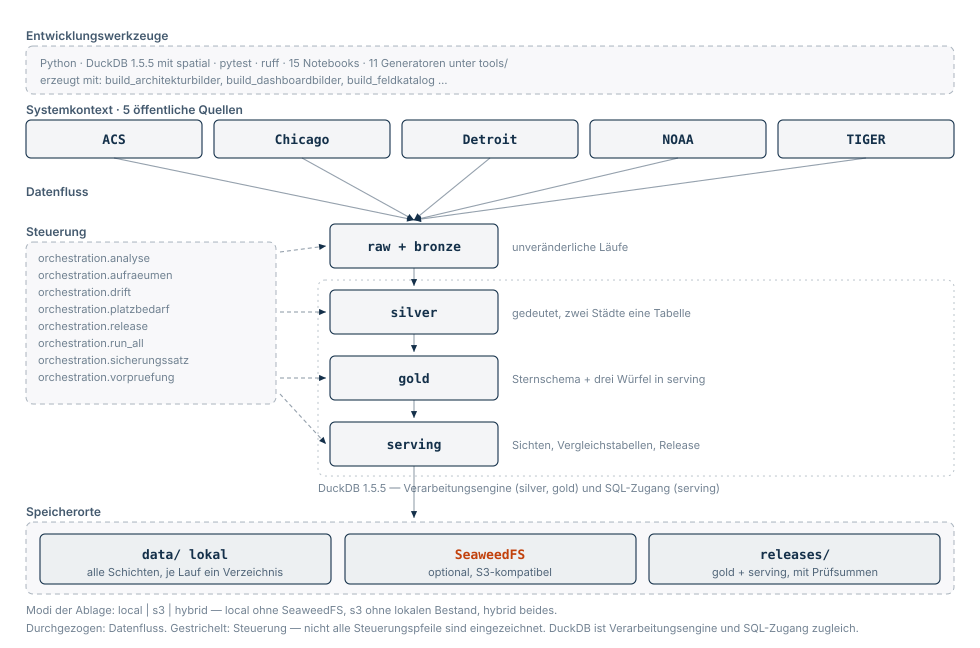
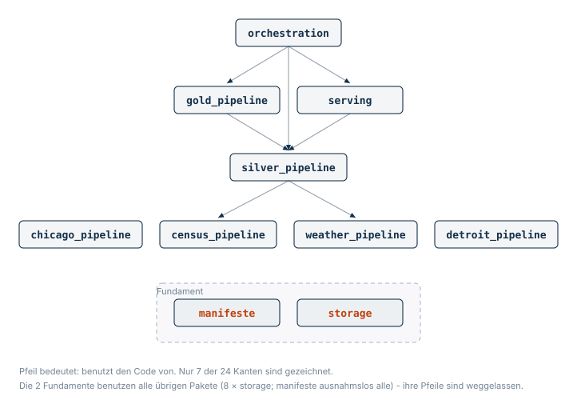
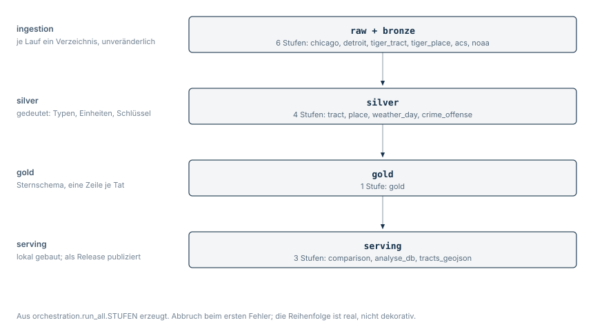

# Der Aufbau, in drei Bildern und einem Lesepfad

Dieses Projekt hat **mehr Erklärung als Code** — rund 12'980 Zeilen Prosa
gegen 12'700 Zeilen Produktionscode, verteilt auf 339 Docstrings, 733
Test-Docstrings und sechzehn Dokumente. Der Abstand ist dabei geschmolzen: Im
Juli standen 11'600 gegen 10'569, ein Zehntel mehr Prosa; heute sind es zwei
Prozent. Was fehlte, war ohnehin kein weiterer Text, sondern ein **Weg
hinein**. Der steht hier.

Alle drei Bilder werden von
[`tools/build_architekturbilder.py`](../tools/build_architekturbilder.py)
**aus dem Code erzeugt**, nicht gezeichnet. Ein Test prüft, dass ein zweiter
Lauf dieselbe Datei liefert — dieselbe Regel wie bei den Crosswalks und beim
Feldkatalog. Ein von Hand gezeichnetes Bild wäre am Tag darauf falsch.

---

## 1 · Die Übersicht

Die Übersicht verknüpft den Systemkontext mit der internen Architektur. Sie
differenziert Entwicklungswerkzeuge, Steuerung, Datenfluss und Speicherorte.



*Komponenten und Beziehungen der Plattform. Quelle: eigene Darstellung,
programmatisch erzeugt aus dem beschriebenen Architekturstand. DuckDB ist
Verarbeitungsengine und SQL-Zugang; SeaweedFS ist die optionale Dateiablage.
Nicht alle Steuerungspfeile sind eingezeichnet.*

**Was daran gelesen wird und was nicht.** Die fünf Quellen kommen aus
`run_all.STUFEN`, die vier Schichten aus `run_all.GRUPPEN`, die
Steuerungsmodule aus dem Verzeichnis `orchestration/`, die Speichermodi aus
`storage.config.BACKENDS` und die DuckDB-Version aus `requirements.lock` —
nicht aus der installierten Umgebung, sonst hinge das Bild am Rechner, auf dem
es entsteht. Fest geschrieben sind nur die Sätze, die nichts zählen, etwa
*„unveränderliche Läufe"*.

**Warum DuckDB erst ab Silver eingerahmt ist.** Raw und Bronze entstehen mit
Python und pyarrow; dort wird nichts gerechnet, sondern abgelegt. Erst Silver
rechnet, und in Serving kommt die zweite Rolle dazu: derselbe Motor ist der
Zugang für eigene Abfragen.

---

## 2 · Wer wessen Code benutzt



Zehn Pakete, 28 Kanten, **keine Zyklen** — das prüft ein Test, denn es ist
eine Aussage über die Architektur und nicht über die Zeichnung.

**Warum nur elf Pfeile gezeichnet sind.** Siebzehn der 28 Kanten zeigen auf
`manifeste` und `storage`. Alle zu zeichnen ergibt ein Knäuel, in dem die
elf übrigen untergehen — und genau die tragen die Aussage. Die beiden
Fundamente stehen deshalb als Band darunter, und die Bildunterschrift sagt,
wer sie benutzt.

> **Das Bild führte diese Zahl bis zum 20.9.2026 selbst falsch.** Der
> Generator rechnete die gezeichneten Pfeile aus, schrieb die Gesamtzahl aber
> als feste `19` daneben. Ein erzeugtes Bild, das eine Zahl mitführt statt sie
> zu rechnen, ist kein erzeugtes Bild — es ist ein gezeichnetes mit einem
> Generator davor.

**Was das Bild über den Entwurf sagt.** `manifeste` hängt an nichts,
`storage` nur an `manifeste`. Zuoberst steht `orchestration`, das Gold und
Serving anstösst. Und zwischen den vier Ingestion-Paketen gibt es **keine
einzige Kante**: Chicago weiss nichts von Detroit. Sie teilen sich nur, wie ein Lauf aussieht (`manifeste`) und wo
er liegt (`storage`).

**Die Lücke, die dieses Bild geschlossen hat.** Konzept 5.3 führte unter
*Data Architecture* wochenlang *„kein Diagramm der Abhängigkeitskanten"*.

---

## 3 · Was beim Laufen geschieht



Erzeugt aus `orchestration.run_all.STUFEN` — die fünfzehn Stufen sind im Code
bereits eine Datenstruktur, das Bild liest sie nur ab. Kommt eine Stufe dazu,
steht sie hier, ohne dass jemand daran denken muss.

### Gold ist der Stern — die Würfel liegen in Serving

Das wird leicht verwechselt, auch von uns. **Gold aggregiert nicht.** Es hält
das Sternschema: `fact_offense` mit einer Zeile je Tat, daneben fünf
Dimensionen (`dim_tract`, `dim_tract_acs`, `dim_offense`, `dim_date`,
`dim_city_day`). Notebook
34 hat gemessen, warum — eine Vorberechnung spart bei 1'851'946 Zeilen nichts,
was ein Mensch bemerkt, kostet aber die Beweglichkeit, für die die Schicht da
ist.

**Drei feste Würfel gibt es trotzdem, eine Schicht weiter.**
`serving.build_comparison` baut sie aus Gold:

| Tabelle | eine Zeile ist | Zeilen |
| --- | --- | ---: |
| `comparison_day` | Stadt × Tag × NIBRS-Kategorie | 13'264 |
| `comparison_week` | Stadt × Woche × Kategorie | 2'506 |
| `comparison_month` | Stadt × Monat × Kategorie | 620 |
| `partition_quality` | Stadt × Monat, Güte der Zuordnungen darunter | 24 |

Sie zählen Taten **und** Fälle, nie Vorfälle — warum, steht in
[`zaehlperspektiven.md`](zaehlperspektiven.md). Ihre Summen gehen nachweislich
auf `fact_offense` auf; ein Test rechnet das nach. Sie sind das, was ein
Dashboard liest und was ein Release mitbringt, und sie ersetzen den Stern
nicht, sondern liegen daneben: Was ein Würfel nicht vorgesehen hat, beantwortet
weiterhin nur `fact_offense`.

`partition_quality` ist dabei kein Würfel, sondern die Fussnote dazu — sie sagt
je Stadt und Monat, wie gut die Zuordnungen sind, auf denen die drei Zahlen
ruhen. Eine Vergleichszahl ohne ihre Abdeckung wäre genau die Art Zahl, vor der
dieses Projekt sonst warnt.

### Die beiden Innenansichten sagen Verschiedenes — und das ist die Pointe

In Bild 2 fehlt eine Kante von `silver_pipeline` zu
`chicago_pipeline`, obwohl Silver Chicagos Daten liest. Im zweiten Bild steht
sie. Kein Widerspruch, sondern der Entwurf:

> **Die Schichten hängen an Dateien, nicht aneinander.**

`silver_pipeline` liest Chicagos Bronze-Läufe über die Ablage — über
`manifest.json` und Parquet, nicht über einen Import. Die Code-Kanten nach
unten holen **Konstanten und Regeln**, keine Daten: `census_pipeline` die
Bundesstaatsnummern, `weather_pipeline` die Stationskennungen. Seit dem
3.10.2026 greifen auch `gold_pipeline` und `orchestration` nach
`census_pipeline` — dort steht, welches ACS-Vintage als Nenner eines
Jahrgangs gilt. Die Regel gehört zur Quelle, und beide brauchen sie: der
Gesamtlauf, um die richtigen Vintages zu laden, Gold, um jeder Tat ihren
Nenner zuzuordnen.

Das ist der Grund, warum eine dritte Stadt keine Änderung an Silver
erzwingt — und warum der Storage-Umbau die Pipelines nicht angefasst hat.

---

## 4 · Ein Lesepfad

Wer zwanzig Minuten hat und verstehen will, wie das Ganze funktioniert, liest
diese sechs Stellen in dieser Reihenfolge. Zusammen sind es rund 400 Zeilen.

| | Wo | Was man danach weiss |
| --- | --- | --- |
| 1 | [`README.md`](../README.md), Abschnitt 2.0 | welche Befehle es gibt und was sie tun |
| 2 | `orchestration/run_all.py` → `STUFEN` | die ganze Strecke in einer Datenstruktur, mit der Reihenfolge und ihrer Begründung |
| 3 | `manifeste/__init__.py` → Modul-Docstring, `Lauf`, `fertige_laeufe` | was ein *Lauf* ist, warum es zwei Status-Vokabulare gibt und wie sie zusammenkommen |
| 4 | `silver_pipeline/build_crime_offense.py` → Modul-Docstring | die fünf Deutungen, die aus zwei Städten eine Tabelle machen — Delikt, Zeitzone, NIBRS, Raum, Granularität |
| 5 | dieselbe Datei → `build_query` | wie das in SQL aussieht: zwei Städte, zwei CTEs, ein `UNION ALL` |
| 6 | `gold_pipeline/build_gold.py` → `fact_offense_query` | der einzige Stellenwechsel zwischen Silver und Gold, und warum es ihn braucht |

### Der Lesepfad für die Kontrollen

Wer wissen will, **was eigentlich geprüft wird**, findet es in
[`notebooks/35_kontrollen.ipynb`](../notebooks/35_kontrollen.ipynb). Dort
stehen alle 42 Kontrollen der Strecke an einem Ort, in der Reihenfolge, in der
sie greifen, und jede wird zweimal vorgeführt: einmal mit Daten, die sie
durchlässt, und einmal mit Daten, die sie fangen soll. Am Schluss reist ein
einzelner Fall durch alle Schichten.

Das Notebook erzeugt seine Beispiele selbst und braucht keine gebauten Daten.

### Der Lesepfad für die Zahlen

Der Pfad oben geht durch den Code. Wen stattdessen interessiert, **woher eine
Zahl kommt**, liest [`eine-zahl.md`](eine-zahl.md): Dort wird die Rate 94,5
über sieben Stufen rückwärts aufgerollt, von der Folie bis zur gzip-Datei der
Stadt Chicago — und dabei kommt jede wesentliche Entscheidung des Projekts
genau einmal vor. Das ist der kürzere Weg zur Frage, die eine Abgabe verdient:
*Woher wisst ihr das?*

Danach lohnen sich je nach Interesse:

* **Warum eine Zahl so ist, wie sie ist** → [`ln2_konzept.md`](ln2_konzept.md)
  Kapitel 5.2 (Serving und Gold), 8.5 und 8.6 (zwei Befunde, die keine
  Fehlermeldung erzeugt hätten)
* **Wo die Daten liegen** → [`storage-architektur.md`](storage-architektur.md)
* **Was eine Spalte bedeutet** → [`feldkatalog.md`](feldkatalog.md), erzeugt
  aus den Manifesten
* **Warum etwas so gekommen ist** → [`AENDERUNGEN.md`](intern/AENDERUNGEN.md)

### Die Tests sind der zweite Lesepfad

512 Test-Docstrings, und sie sind keine Floskeln — sie sagen, *warum* eine
Zusage besteht:

> *„Die Drift, die dreimal passiert ist: eine Lücke, die längst geschlossen
> war."*
> *„Der Fall, für den es das Gate gibt."*

```bash
python -m pytest --collect-only -q
```

Das ist die Liste dessen, was dieses Projekt über sich selbst prüft.

### Der dritte Lesepfad: das Nachschlagewerk

Die 295 Docstrings stehen im Code — und damit an der einzigen Stelle, an der
man sie nur findet, wenn man schon weiss, wo man suchen muss. Ein Aufruf macht
sie blätterbar:

```bash
python tools/build_referenz.py
```

Das schreibt [`docs/referenz/`](referenz/index.html): eine Seite je Modul,
durchsuchbar, mit dem Quelltext daneben. Die Startseite ordnet die zehn Pakete
in der Reihenfolge des Gesamtlaufs — auch sie erzeugt, aus `run_all.STUFEN`.

Das Verzeichnis liegt im Repository, wie die Crosswalks und die beiden Bilder
darüber: Was sich byteweise reproduzieren lässt, gehört hinein. Ein Test hält
das Abgelegte gegen einen frischen Bau.

### Und vier Befehle, die zeigen statt behaupten

```bash
python -m orchestration.run_all --trocken   # 15 Stufen, in Reihenfolge
python -m storage                            # wo die Daten liegen, welcher Stand
python -m orchestration.drift                # wie weit die Zahlen vom Referenzstand weg sind
python -m orchestration.aufraeumen           # was bleiben muss und warum
```
